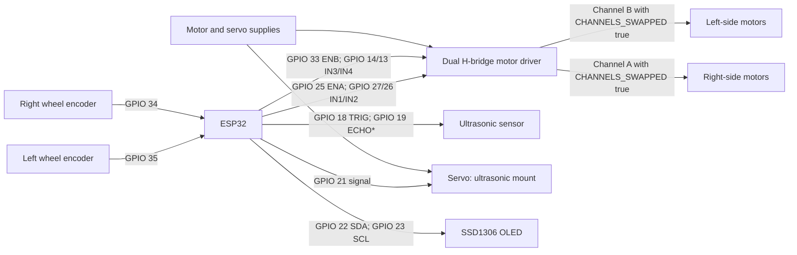

# Project WALL-E

An ESP32-based differential-drive robot car with a Wi-Fi control dashboard and four operating modes: Manual, Auto coordinate navigation, Object Follower, and Dodge obstacle avoidance. The firmware also reports wheel-derived speed on an OLED and uses a servo-mounted ultrasonic sensor for range scanning.

> **Hardware note:** Pin assignments and motor-channel orientation below match the included sketch. Confirm your own driver board and wiring before powering the motors. ESP32 GPIO is 3.3 V logic; never feed 5 V into an ESP32 input.

## Features

- **Manual:** browser-based drive controls with command timeout and emergency stop.
- **Auto:** accepts destination coordinates in centimetres relative to the boot-time origin. It traverses the Y leg first, then the X leg. Positive Y is forward, negative Y is reverse, positive X is right, and negative X is left. The ultrasonic sensor triggers a scan-and-bypass routine when an obstacle is within the configured safety range.
- **Follower:** sweeps the servo-mounted ultrasonic sensor to find a nearby object and steers toward it. It advances when the target is farther than 15 cm and within the 30 cm tracking range, holds at 10–15 cm, and reverses below 10 cm.
- **Dodge:** drives forward and reacts to readings from 15 through 25 cm. It stops, reverses, scans both sides with the servo, turns toward the clearer side, then continues.
- **Speed and mode display:** OLED shows the active mode and wheel-encoder speed, capped at 10 km/h. Auto obstacle bypass is shown as Dodge.

## Hardware connections

### ESP32 pin map

| Function | ESP32 pin | Connect to / notes |
|---|---:|---|
| Driver channel A PWM | GPIO 25 (`ENA`) | Channel A enable/PWM; maps to the car's physical right side with the included channel-swap setting |
| Driver channel A direction 1 | GPIO 27 (`IN1`) | Channel A input 1 |
| Driver channel A direction 2 | GPIO 26 (`IN2`) | Channel A input 2 |
| Driver channel B direction 1 | GPIO 14 (`IN3`) | Channel B input 1 |
| Driver channel B direction 2 | GPIO 13 (`IN4`) | Channel B input 2 |
| Driver channel B PWM | GPIO 33 (`ENB`) | Channel B enable/PWM; maps to the car's physical left side with the included channel-swap setting |
| Right wheel encoder | GPIO 34 | Conditioned 0–3.3 V encoder output; input-only pin, no internal pull-up |
| Left wheel encoder | GPIO 35 | Conditioned 0–3.3 V encoder output; input-only pin, no internal pull-up |
| Ultrasonic trigger | GPIO 18 | HC-SR04-compatible `TRIG` |
| Ultrasonic echo | GPIO 19 | `ECHO` through a level shifter or resistor divider if the sensor outputs 5 V |
| Servo signal | GPIO 21 | Servo signal wire; use a suitable external servo supply |
| OLED SDA | GPIO 22 | SSD1306 SDA |
| OLED SCL | GPIO 23 | SSD1306 SCL |
| Common ground | GND | Tie ESP32, motor driver, sensor, servo supply, OLED, and encoder grounds together |

`CHANNELS_SWAPPED` is enabled in the sketch: its logical left motor channel is wired to the car's physical right side. Keep this setting only if that matches your build.

### Connection diagram

`*` Protect GPIO 19 from a 5 V Echo signal. Power motors and servo from supplies sized for their current; do not power them from the ESP32 3.3 V pin. Join all grounds. Encoder outputs must be clean 0–3.3 V signals; GPIO 34 and 35 do not provide internal pull-ups.

## Coordinate convention

The robot's pose origin is set during boot, with heading initially assumed to face +Y. Coordinates are in centimetres. For example, `(X=+220, Y=-100)` means reverse 100 cm along the initial +Y axis, pivot clockwise to face +X, then drive forward 220 cm. Encoder odometry is relative and may drift; it is not an absolute-position sensor.

## Build and run

1. Open `ESP32_Robot_Car.ino` in Arduino IDE.
2. Select an ESP32 board/core compatible with the sketch's LEDC API.
3. Install **Adafruit GFX Library** and **Adafruit SSD1306** from Library Manager. `WiFi`, `WebServer`, and `Wire` are provided by the ESP32 Arduino core.
4. Check the pin map, motor polarity, `CHANNELS_SWAPPED`, servo scan direction, wheel diameter, encoder pulses per revolution, and wheel track against the actual car.
5. Upload with the drive wheels lifted for the first motor-direction and sensor checks.
6. Join the car's access point (`ESP32_Car_Control`) and open `http://192.168.4.1`.
7. Select a mode. In Auto, enter an X and Y destination in centimetres. Release emergency stop before submitting a target.

The sketch currently contains a default access-point password (`password123`). Change the firmware credentials before using the car on a shared or untrusted network.

## Calibration and limitations

- Set `WHEEL_CIRCUMFERENCE_CM`, `ENCODER_PULSES_PER_REV`, and `WHEEL_TRACK_CM` from measurements of the assembled car. Incorrect values affect distance, heading, and Auto completion.
- GPIO 34/35 encoder signals must be electrically conditioned and connected correctly. The sketch's single-channel odometry infers direction from the motor command; it cannot detect wheel slip or an encoder wired to the wrong wheel.
- Verify that positive motor commands move both sides forward and that the servo's left/right scan angles match the physical mount. Adjust `CHANNELS_SWAPPED` and `SERVO_HIGH_IS_LEFT` if required.
- Perform initial tests at low speed in an open area with an accessible power switch. Ultrasonic sensors can miss angled, soft, narrow, or out-of-range objects.
- Speed display is capped at 10 km/h; this is a display limit, not a speed controller or safety-rated measurement.

## Conclusion

Project WALL-E combines web-based manual control with encoder-guided coordinate movement, ultrasonic object following, and servo-assisted obstacle avoidance in a single ESP32 sketch. Accurate and dependable operation requires correct wiring, clean encoder signals, and calibration on the assembled robot. Test each mode with the wheels raised before allowing the car to drive on the floor.
